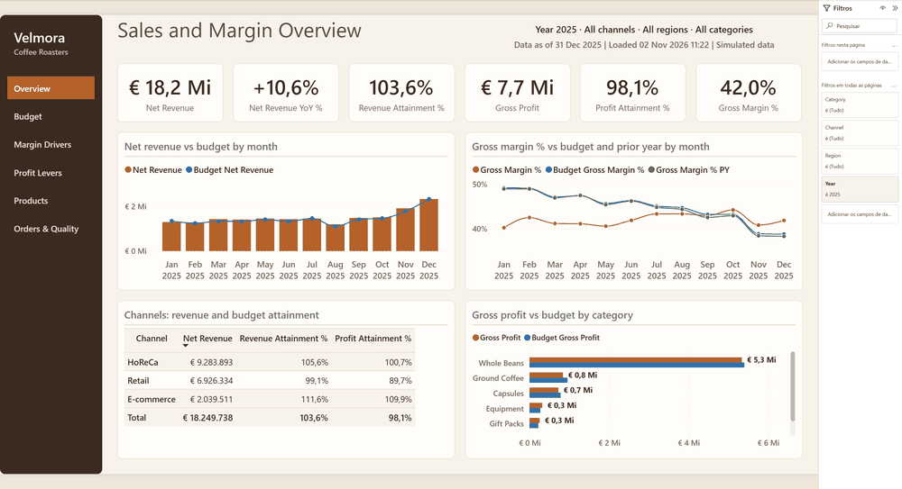
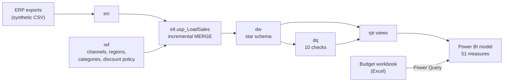
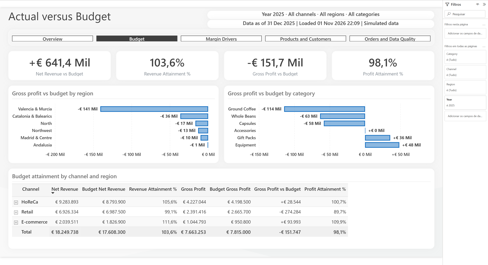
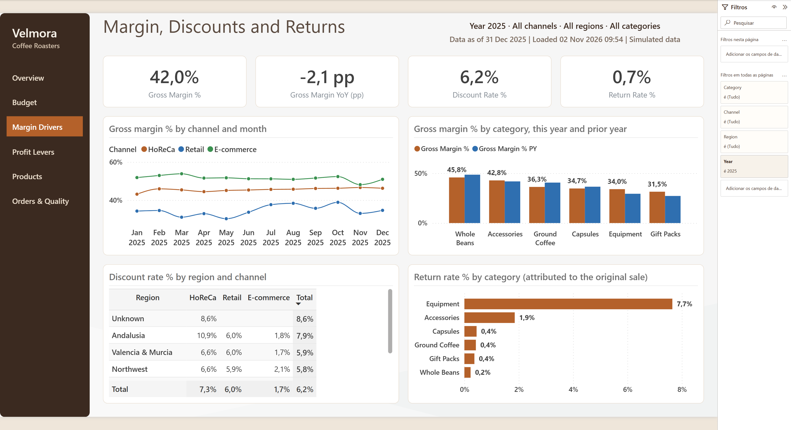
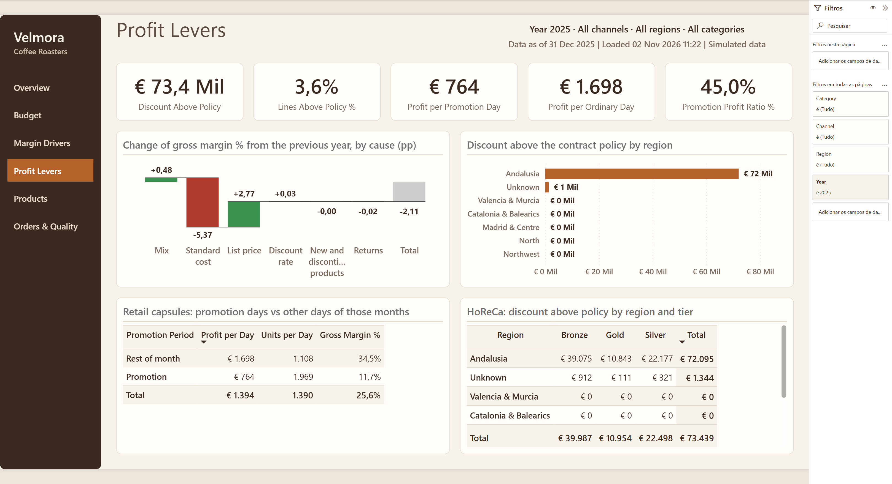
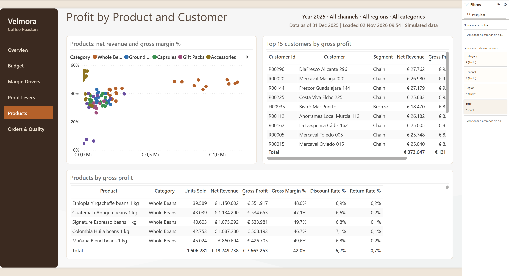
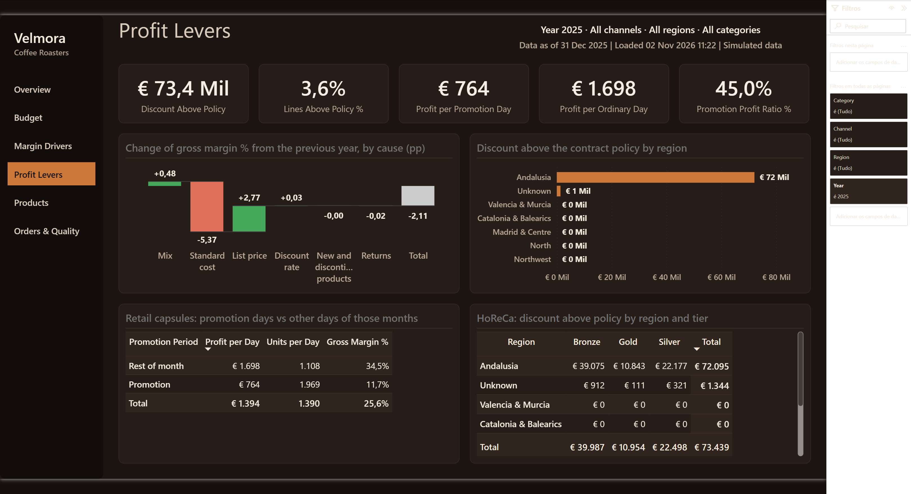

# Sales & Revenue Analytics

> Portfolio project by Gustavo Silveira, Senior Data & BI Analyst · Scylla Data Lab.
> **Simulated scenario:** Velmora Coffee Roasters, its customers, data and every result shown are fictional.
> The data is synthetic and was generated with known defects and business patterns.

Sales, margin and budget analytics for a (fictional) Spanish specialty coffee roaster that sells through HoReCa,
retail and e-commerce: revenue and gross profit by channel, region, category and customer, actual against the
finance budget, and why the margin fell.

Built with **SQL Server (T-SQL)**, **Power BI (PBIP: TMDL + PBIR)**, **Power Query**, **Python** and PowerShell.



## In 30 seconds

| | |
|---|---|
| **The problem** | Revenue grew for two years and gross profit did not. The monthly close came from three spreadsheets that disagreed, and the budget arrived as an Excel file nobody compared reliably. |
| **What was delivered** | A SQL Server database with an incremental, re-runnable load; ten data quality checks; a Power BI model with the budget prepared in Power Query; a six-page report; an analysis of the margin fall with recommendations, three of them built into the report after client approval. |
| **Why the numbers can be trusted** | 18 KPIs recomputed by independent SQL from the source tables, and the margin bridge recomputed in SQL, match Power BI in 231 of 231 comparisons. A full reload after an incremental one changes 0 rows. The prepared budget equals the workbook's own totals. |
| **What the analysis found** | Cost explains the whole margin fall (−10.3 points); the price increase recovered 2.8. The budget misses gross profit because finance plans with last year's margin. Andalusia discounts exceed policy, and retail capsule promotions lose profit. |

## The business problem

Velmora's leadership could not say how much of the gap between revenue and profit came from green coffee cost,
product mix, discounts or returns, and whether they were meeting the budget
(`docs/01-business-requirements.md`). Eight calculation rules were agreed before any build: revenue on the
invoice date, returns in the credit note month, standard cost of the invoice month, returned equipment back to
stock, average order value only within one channel, and so on.

## Solution



- **Incremental and safe to re-run.** The load finds the orders affected by any source change since the last
  run (order, lines, invoice, credit notes, customer, product, standard cost) and rebuilds their rows with
  `MERGE`. Watermarks per source table, an application lock against concurrent runs, one transaction, a run log
  and a full-reload option. A test applies a day of ERP changes and proves that a full reload afterwards finds
  nothing to change.
- **Source defects handled, not hidden.** Duplicate customers, a missing monthly cost, returns above the
  invoiced quantity, invoices dated before their order, customers without region: each has a rule, a flag on the
  affected rows and a check.
- **Budget from Excel, in Power Query.** Title rows and totals skipped, months unpivoted, misspelt categories
  mapped, regions normalised, and the result reconciled with the workbook's Total rows.
- **A light model.** Import mode, star schema, single-direction relationships, explicit measures only. Budget
  measures go blank where the budget does not exist (by customer or product).

## Report

| Page | Answers |
|---|---|
| Overview | How much did we sell and keep, against budget and last year? |
| Budget | Where do we miss the revenue and gross profit budget? |
| Margin Drivers | How did the margin move by channel and category? Where are discounts and returns high? |
| Profit Levers | Which parts explain the margin change? Where are discounts above the contract policy? Do promotions pay? |
| Products and Customers | Which products and customers bring profit, and which only volume? |
| Orders and Data Quality | Orders, cancellations, average order value by channel; can the numbers be trusted? |

| | |
|---|---|
|  |  |
|  |  |

Screenshots were taken from the report open in Power BI Desktop. The report has its own design ("Velmora Roast":
espresso navigation rail, cream canvas, caramel for actuals, slate blue for budget and prior year; the palette
passes a colour-vision validator). A dark variant on the same model, "Velmora Dark Roast"
(`powerbi/VelmoraSales-Dark.pbip`), is shown in `docs/screenshots/dark/`:

 The model and the report are generated by scripts (`powerbi/generate_model.py`, `powerbi/build_report.py` with the `pbir` CLI), so both can be rebuilt and
reviewed as code.

## Findings (simulated data)

| Finding | Evidence |
|---|---|
| The margin fell from 48.9 % to 42.0 % because of standard cost (−10.3 pp); list prices recovered +2.8 pp; mix helped (+0.6 pp) | `analysis/margin_bridge.sql` |
| Gross profit misses the budget through margin, not volume (2024: −€855k margin, +€290k volume) | `analysis/budget_gap.dax` |
| Retail raised prices five months late: about €172k of gross profit (estimate) | `analysis/insights.sql` |
| HoReCa in Andalusia: 62 % of lines above the contract discount policy, €72k in 2025 | `analysis/insights.sql` |
| Retail capsule promotions earn 45 % of an ordinary day's gross profit | `analysis/insights.sql` |

Details and recommendations: `docs/06-insights.md`. Three of them became report changes after the (fictional)
client approved them (`docs/02-change-log.md`, CR-01 to CR-03).

## Run it

Needs SQL Server with Windows authentication, ODBC Driver 18 for SQL Server, Python 3.11+ and Power BI Desktop.

```bash
python -m venv .venv
.venv/Scripts/python -m pip install -r requirements.txt
powershell -ExecutionPolicy Bypass -File build.ps1
```

`build.ps1` generates the data, creates the `VelmoraSales` database, loads it, runs the checks and writes the
semantic model with the budget path of your clone (45 s on the development machine). Then open
`powerbi/VelmoraSales.pbip` (or the dark design, `powerbi/VelmoraSales-Dark.pbip`) in Power BI Desktop and refresh.
The budget path that `build.ps1` writes into `expressions.tmdl` is local to your machine; the committed file holds a
placeholder. Tests:

```bash
powershell -ExecutionPolicy Bypass -File tests/test_incremental_load.ps1
```

```bash
powershell -ExecutionPolicy Bypass -File validation/validate_kpis.ps1
```

The second one needs the report open in Power BI Desktop.

## Repository

| Path | Content |
|---|---|
| `docs/` | Requirements, change log, data model, KPI dictionary, validation results, insights, learning guide |
| `generator/` | Synthetic ERP exports and budget workbook |
| `database/` | Deployment scripts, source loader, processing runner |
| `tests/` | Incremental load test and the simulated ERP changes it applies |
| `powerbi/` | PBIP project and the scripts that write it |
| `validation/` | Independent SQL KPIs and the comparison with Power BI |
| `analysis/` | Queries behind the findings |
| `TECHNICAL_DECISIONS.md` | Why it is built this way, and what was given up |

## Limitations

Synthetic data with patterns chosen in advance; no real company or result. The refresh is not scheduled and the
report is not published (out of scope). Interactions, accessibility and report performance were not formally
tested (`docs/05-validation-results.md`).

## Contact

Gustavo Silveira · [LinkedIn](https://www.linkedin.com/in/gustavo-d-silveira-72b9b9218/) ·
[scylla.datalab@outlook.com](mailto:scylla.datalab@outlook.com). Available for Power BI, SQL Server and Python
projects, remote or in Spain.

## Resumen en español

Proyecto de portafolio con datos sintéticos: analítica de ventas, margen y presupuesto para un tostador de café
de especialidad ficticio con tres canales (HoReCa, retail y e-commerce). SQL Server con carga incremental
idempotente (MERGE, marcas de agua, bloqueo de aplicación, registro de ejecuciones), diez controles de calidad,
modelo Power BI en PBIP con el presupuesto preparado en Power Query desde Excel, e informe de seis páginas. Los
KPI principales coinciden con un cálculo SQL independiente en 231 de 231 comparaciones, y una recarga completa
tras la incremental no cambia ninguna fila. El análisis muestra que el coste estándar explica toda la caída del
margen (−10,3 puntos) y que el presupuesto falla en beneficio bruto porque se planifica con el margen del año
anterior.

## License

MIT, see `LICENSE`.
