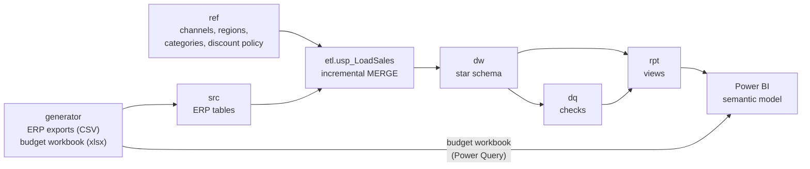

# Data Model

> **SIMULATED SCENARIO.** Velmora Coffee Roasters and all its data are fictional.

## Layers

| Schema | Content | Written by |
|---|---|---|
| `src` | ERP exports: products, customers, price list, monthly standard cost, orders and lines, invoices, credit notes and lines. Every row has a `ModifiedAt` timestamp. | `database/load_source_data.py` (here); the ERP extraction in a real deployment |
| `ref` | Channels, regions (plus `UNK`), categories (with the restockable flag of rule R5), contract discount policy by channel and segment (R9), promotion calendar (R11) | `database/01_reference_tables.sql` |
| `dw` | Star schema below | `etl.usp_LoadSales` |
| `etl` | Watermark per source table, run log | `etl.usp_LoadSales` |
| `dq` | Check results and the views that list affected rows | `dq.usp_RunChecks` |
| `rpt` | One view per Power BI table; the model reads nothing else | `database/06_rpt_views.sql` |

The budget never enters SQL Server: finance sends an Excel workbook every year and rule R7 asks for it to be
prepared in Power Query.

## Star schema

| Table | Grain | Notes |
|---|---|---|
| `dw.FactSales` | One invoice line or one credit note line | Signed: return rows have negative quantity and net revenue. `PostingDate` is the invoice or credit note date (R1, R4); `OriginalInvoiceDate` attributes a return to its sale. Amounts exclude VAT and are rounded to cents per line. |
| `dw.FactOrderLine` | One order line, any status | Orders taken, cancellations and open orders by order date (R3) |
| `dw.DimCustomer` | Customer (SCD type 1) | Region `UNK` when the export has none |
| `dw.DimProduct` | Product (SCD type 1) | |
| `dw.DimDate` | Day | Whole years covering every source date |
| `ref.Channel`, `ref.Region`, `ref.Category` | Small conformed dimensions | Exposed through `rpt` views |

Both facts carry the channel, region and category codes directly. The budget is planned at channel × region ×
category × month, so actuals and budget filter through the same three small dimensions with single-direction
relationships. The alternative, budget related to customer and product dimensions, would need many-to-many
relationships.

### Amounts on a fact row

| Column | Invoice line | Return line |
|---|---|---|
| `Quantity` | invoiced units | − returned units, capped at the invoiced units |
| `GrossSales` | quantity × list price | 0 |
| `DiscountAmount` | gross × line discount % | 0 |
| `ReturnAmount` | 0 | returned units × list price × (1 − discount %) |
| `NetRevenue` | gross − discount | − return amount |
| `Cogs` | units × standard cost of the invoice month | − units × that cost for restockable categories (accessories, equipment); 0 for coffee, which is written off |
| `IsPolicyChecked` | 1 when the order has no campaign and the line is not a free sample (R9) | 0 |
| `DiscountAbovePolicy` | gross × (line discount − contract maximum of the segment), on checked lines (R9) | 0 |
| `PromotionPeriod` | `Promotion` inside a promotion window for the line's channel and category, `Rest of month` on the other days of that month, empty elsewhere; by order date (R11) | same as the invoice line |

## Incremental load (`etl.usp_LoadSales`)

An order is reprocessed when anything that feeds its rows changed since the last run: the order, its lines, its
invoice, its credit notes, its customer, one of its products, or a standard cost of one of its products for the
invoice month or an earlier month (a missing month carries the earlier cost forward). For every affected order
the procedure rebuilds the fact rows in memory and applies them with `MERGE`: insert, update only when a value
differs, delete when the source no longer has the row.

- **Watermarks**: one per source table. The new values are read before the changes, so a row written during a
  run is picked up again by the next one.
- **Concurrency**: `sp_getapplock` in exclusive mode; a second run fails at once and is logged.
- **Atomicity**: one transaction with `XACT_ABORT`; a failure leaves dw as it was and the run log says why.
- **Full reload**: `@FullReload = 1` resets the watermarks, reprocesses every order and removes fact rows whose
  order no longer exists. It also trims the calendar to the source years.
- **Assumption**: the ERP cancels or deactivates orders, customers and products; it never hard-deletes them.
  An incremental run would not notice a hard delete; a full reload would.
- **Reference changes**: `ref` tables have no timestamps; a change to the discount policy or the promotion
  calendar needs a full reload.
- **Limitation**: the watermark trusts the ERP's `ModifiedAt`. A transaction committed late with an older
  timestamp would be missed by the incremental run until the next full reload.

Processing order for a scheduler (not configured in this project): `database/refresh.ps1` runs the load and the
checks and exits with an error when either fails, so the Power BI refresh can be held.

## Source defects

The ERP exports contain defects that real exports have. Each one is handled by a rule and counted by a check.

| Check | Defect | Handling |
|---|---|---|
| SRC-01 | Same customer under two ids (same channel, name and city) | Kept separate and listed in `dq.vw_PossibleDuplicateCustomer`: merging needs a business decision |
| SRC-02 | No standard cost for a product-month with invoices | Latest earlier cost of the product, line flagged `IsCostCarriedForward` |
| SRC-03 | Credit note for more units than invoiced | Returned units capped at the invoiced units, line flagged `IsQuantityCapped` |
| SRC-04 | Invoice dated before its order | Invoice date kept as the revenue date (R1), flagged `IsInvoiceBeforeOrder` |
| SRC-05 | Customer without region | Region Unknown (`UNK`); counted in every total, in no regional budget |
| Budget | Title rows, a Total row, misspelt categories ("Capsule", "Accesories"), a lower-case region | Power Query skips titles and totals, maps category names to codes, upper-cases regions; the Budget Workbook Difference measure checks the result against the workbook's own Total rows |

Integrity checks INT-01 to INT-05 compare dw with src (every invoice line, credit note line and order line
present exactly once), and confirm that cancelled or open orders carry no revenue and that no order line ends with
negative net revenue.

## Semantic model

Import mode, 14 tables, 17 single-direction relationships, 51 explicit measures in `_Measures`, no calculated
columns. Written by `powerbi/generate_model.py` and checked offline by `powerbi/validate_model.ps1`.

| Table | Source |
|---|---|
| Date, Channel, Region, Category, Customer, Product | `rpt` views |
| Sales, Order Line | `rpt.vw_Sales`, `rpt.vw_OrderLine` |
| Budget, Budget Workbook Total | The finance workbook, through the staging query `Budget Sheets` |
| Data Quality Check, Processing Status | `rpt` views |
| Margin Bridge Step | Six fixed rows in Power Query: the axis of the margin bridge waterfall (R10) |

`Sales[Original Invoice Date]` has an inactive relationship to Date, used by `Return Rate %` with
`USERELATIONSHIP`. Budget measures return blank when customers, products or sales attributes are filtered,
because the budget does not exist at that grain.
